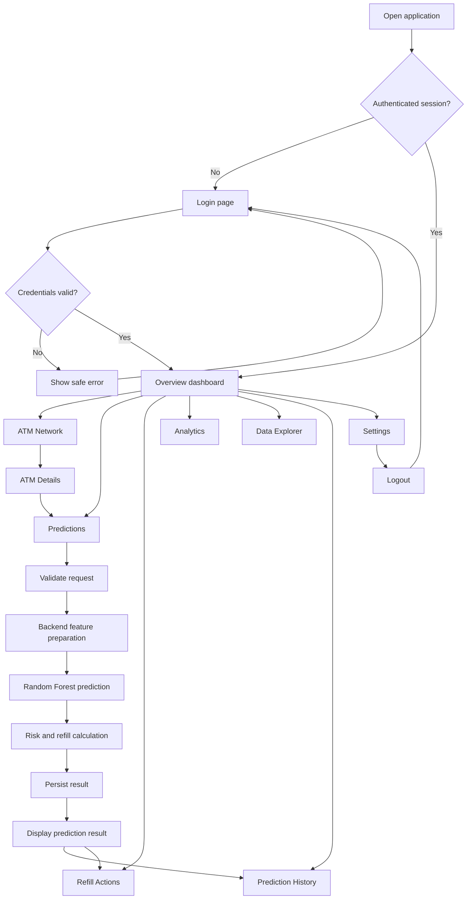
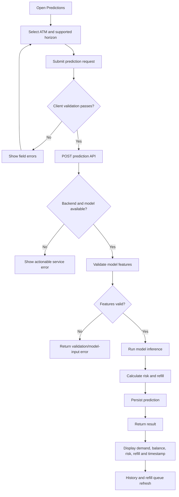

# Application Flow
## ATM Cash Demand Predictor

## 1. Global navigation flow

## 2. Login flow

1. User opens the application.
2. If there is no valid session, show Login.
3. User enters username and password.
4. Frontend submits credentials to the backend.
5. On success, establish the configured session and navigate to Overview.
6. On failure, show a concise error without revealing whether a particular username exists.
7. Protected routes redirect to Login if authentication is missing or expired.

## 3. Overview flow

1. Load overview data and system status from API.
2. Show skeletons while requests are pending.
3. Render KPIs, demand trend, risk distribution, attention table, recent predictions, and service status.
4. If one widget fails, show a localized error where possible rather than blanking the whole page.
5. Selecting an ATM opens ATM Details; selecting a prediction opens its details/history.

## 4. ATM Network flow

1. Load paginated ATM records.
2. User searches by ATM ID/name/city/address and applies supported filters.
3. Send search/filter/page parameters to the backend.
4. Display matching records, current balance, risk/status when known.
5. Open an ATM row to view details.
6. Provide a clear empty state when no ATMs match.
7. Only show a map if valid coordinates and a map implementation exist; otherwise use the table as the authoritative view.

## 5. Prediction flow

Important: the backend must define the real prediction horizon. Do not label a prediction “next 7 days” unless the model/service actually forecasts that period.

## 6. Risk and refill decision flow

Given predicted demand `D` and current balance `B`:
1. Validate that `D` and `B` are numeric and finite.
2. Calculate required cash: `D × 1.2`.
3. Calculate refill: `max(0, D × 1.2 − B)`.
4. Classify risk:
   - HIGH if `B < D`.
   - MEDIUM if not HIGH and `B < 1.5 × D`.
   - LOW otherwise.
5. Return one consistent result from the backend.
6. Store the result and show it in the UI.

Define and test behavior for zero/negative demand, missing balance, rounding, and currency precision.

## 7. Refill Actions flow

1. Load recommendations from persisted predictions or a dedicated backend service.
2. Filter by risk, city, and workflow status where supported.
3. Sort by risk/priority using a documented rule.
4. Open details and review the recommendation.
5. If review status is supported, record the review action with user and timestamp.
6. Never label a recommendation as “cash refilled” unless a real verified refill event is recorded.

## 8. Data Explorer flow

1. Select either Source Transactions or Engineered Features.
2. Load a paginated result set.
3. Apply search/date/ATM filters.
4. Show schema/validation summaries supplied by the backend.
5. Handle missing permissions, empty data, and API errors.

## 9. Analytics flow

1. User chooses a date range.
2. Frontend requests aggregated time-series and evaluation metrics.
3. Backend returns data and metric provenance.
4. Render actual-versus-predicted trend, risk over time, and ATM comparisons.
5. Show “Not available” for metrics that have not been calculated; do not fabricate accuracy.

## 10. Prediction History flow

1. Request paginated prediction records.
2. Apply date, ATM, and risk filters.
3. Open a record to see its input context and output.
4. Keep historical results immutable unless the system explicitly supports corrections with audit logging.

## 11. Settings and logout flow

1. Load profile and system status.
2. Allow only settings supported by backend APIs.
3. Protect password changes with current-password verification if required.
4. Logout clears/revokes the session according to the chosen auth implementation.
5. Return to Login and block protected routes.

## 12. Global UI states

All API-driven screens must support:
- Loading.
- Success/data available.
- Empty data.
- Validation failure.
- Network/API failure.
- Unauthorized/session expired.
- Model unavailable.
- Database unavailable or degraded mode.
- Retry where safe.
