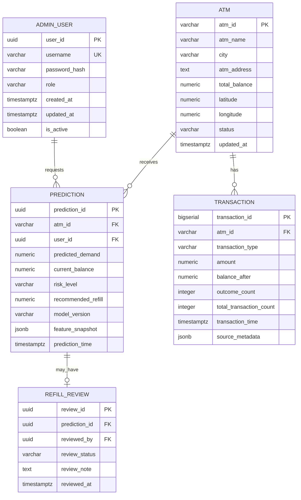

# Backend Schema
## ATM Cash Demand Predictor

## 1. Schema principles

This is a recommended logical schema based on the supplied SRS. Inspect the existing dataset and backend before implementing migrations. Match actual column names and types where possible. The SRS describes four main entities: `ADMIN_USER`, `ATM`, `TRANSACTION`, and `PREDICTION`. A refill review table/status and audit records are optional extensions.

Use PostgreSQL as the primary database. Store timestamps with timezone (`TIMESTAMPTZ`), currency amounts using `NUMERIC` rather than floating-point database types, and stable primary keys.

## 2. Entity relationships



`REFILL_REVIEW` is an optional extension, not a stated core SRS entity. If only a simple review state is needed, status fields may instead be added to a separate recommendation entity or carefully to `PREDICTION`. Avoid duplicating status without a clear reason.

## 3. Table definitions

### 3.1 `admin_user`
Purpose: administrator authentication and authorization.

| Column | Suggested type | Rules |
|---|---|---|
| `user_id` | UUID | Primary key |
| `username` | VARCHAR(100) | Unique, required |
| `password_hash` | TEXT | Required; never plaintext |
| `role` | VARCHAR(30) | Required; allow-listed roles |
| `is_active` | BOOLEAN | Default true |
| `created_at` | TIMESTAMPTZ | Required |
| `updated_at` | TIMESTAMPTZ | Required |

Never return `password_hash` in API responses.

### 3.2 `atm`
Purpose: ATM identity and latest known balance.

| Column | Suggested type | Rules |
|---|---|---|
| `atm_id` | VARCHAR(50) | Primary key; preserve source IDs |
| `atm_name` | VARCHAR(200) | Nullable if source lacks it |
| `city` | VARCHAR(120) | Indexed if filtered often |
| `atm_address` | TEXT | Nullable if unavailable |
| `total_balance` | NUMERIC(14,2) | Latest known balance, not necessarily live |
| `latitude` | NUMERIC(9,6) | Optional; only valid source coordinates |
| `longitude` | NUMERIC(9,6) | Optional; only valid source coordinates |
| `status` | VARCHAR(30) | Controlled values, if source supports status |
| `updated_at` | TIMESTAMPTZ | Last record update |

Do not invent coordinates or claim a balance is real-time unless the data feed supports that.

### 3.3 `transaction`
Purpose: imported historical transaction observations. `transaction` can be a reserved word in some contexts; the physical table may be named `atm_transaction`.

| Column | Suggested type | Rules |
|---|---|---|
| `transaction_id` | BIGSERIAL | Primary key |
| `atm_id` | VARCHAR(50) | Foreign key to `atm` |
| `transaction_type` | VARCHAR(40) | Source-defined type |
| `amount` | NUMERIC(14,2) | Source amount |
| `balance_after` | NUMERIC(14,2) | Nullable |
| `outcome_count` | INTEGER | Nullable if source lacks count |
| `total_transaction_count` | INTEGER | Nullable if source lacks count |
| `transaction_time` | TIMESTAMPTZ | Required for time-series work |
| `source_metadata` | JSONB | Optional original fields not yet normalized |

Preserve original source fields during ingestion. Map fields carefully rather than assuming that every dataset column has the names above.

### 3.4 `prediction`
Purpose: persisted model output and derived operational result.

| Column | Suggested type | Rules |
|---|---|---|
| `prediction_id` | UUID | Primary key |
| `atm_id` | VARCHAR(50) | Foreign key to `atm` |
| `user_id` | UUID | Foreign key to requesting administrator |
| `predicted_demand` | NUMERIC(14,2) | Required, finite and non-negative according to model policy |
| `current_balance` | NUMERIC(14,2) | Balance used in the calculation |
| `risk_level` | VARCHAR(10) | `HIGH`, `MEDIUM`, or `LOW` |
| `recommended_refill` | NUMERIC(14,2) | Non-negative |
| `model_version` | VARCHAR(100) | Optional but recommended |
| `feature_snapshot` | JSONB | Optional auditable feature values; exclude sensitive data |
| `prediction_time` | TIMESTAMPTZ | Required |

The prediction response should make clear that `current_balance` is the balance used when the prediction was created, which may differ from the latest ATM balance later.

### 3.5 Optional `refill_review`
Purpose: record administrator review of a refill recommendation, without implying physical cash delivery.

| Column | Suggested type | Rules |
|---|---|---|
| `review_id` | UUID | Primary key |
| `prediction_id` | UUID | Foreign key to prediction |
| `reviewed_by` | UUID | Foreign key to administrator |
| `review_status` | VARCHAR(30) | e.g. `PENDING`, `REVIEWED`, `DISMISSED` |
| `review_note` | TEXT | Optional |
| `reviewed_at` | TIMESTAMPTZ | Nullable until reviewed |

If multiple review events per prediction must be audited, use a review-event table rather than overwriting past events.

## 4. Indexes and constraints

Recommended indexes:
- `atm(city)`
- `atm_transaction(atm_id, transaction_time DESC)`
- `prediction(atm_id, prediction_time DESC)`
- `prediction(prediction_time DESC)`
- `prediction(risk_level, prediction_time DESC)`
- `prediction(user_id, prediction_time DESC)`

Recommended constraints:
- Unique username.
- Foreign keys for ATM and administrator relationships.
- Risk level check constraint.
- Non-negative refill constraint.
- Non-negative balance/demand where consistent with the dataset/business rules.
- Controlled review status values.
- Avoid cascading deletion of prediction/audit records unless explicitly required.

## 5. Risk and refill calculations

Canonical backend logic:

```python
required_cash = predicted_demand * 1.2
recommended_refill = max(0, required_cash - current_balance)

if current_balance < predicted_demand:
    risk_level = "HIGH"
elif current_balance < 1.5 * predicted_demand:
    risk_level = "MEDIUM"
else:
    risk_level = "LOW"
```

Validate values before calculation. Define rounding policy explicitly. Use decimal-safe handling where financial precision matters. The example shows the business rule from the SRS; test edge cases before release.

## 6. Feature configuration

The model expects these features in the saved order:

1. `hour`
2. `day_of_week`
3. `is_weekend`
4. `is_holiday`
5. `totalBalance`
6. `numberOutcomeTransaction`
7. `totalNumberTransaction`
8. `previous_demand`
9. `previous_transaction_count`
10. `rolling_mean_3`

The persisted feature configuration or model artifact is authoritative. Validate the feature list/order at startup and before inference. Never build a prediction request from arbitrary browser-supplied features unless that is explicitly part of the model contract.

## 7. Suggested response schemas

### ATM summary
```json
{
  "atm_id": "ATM001",
  "atm_name": "Example ATM",
  "city": "Example City",
  "atm_address": null,
  "current_balance": 42000,
  "risk_level": "HIGH",
  "status": "ACTIVE"
}
```

### Prediction result
```json
{
  "prediction_id": "example-uuid",
  "atm_id": "ATM001",
  "predicted_demand": 120000,
  "current_balance": 42000,
  "risk_level": "HIGH",
  "recommended_refill": 102000,
  "prediction_time": "2026-10-27T10:00:00Z",
  "model_version": "example-version"
}
```

These values are examples only, not actual system results.

## 8. Migration and data import strategy

1. Inspect source CSV schema and current database.
2. Preserve source records and document column mapping.
3. Normalize ATM identity and timestamps.
4. Validate missing values, duplicates, numeric types, and timezones.
5. Import ATM and transaction data using repeatable scripts.
6. Record import summary and errors.
7. Verify row counts and representative records.
8. Ensure engineered features match the trained model's exact expected schema.
9. Do not create synthetic live-looking records unless they are clearly labeled as demo data.

## 9. Data retention and audit

Document retention for imported transactions, predictions, and review events. Restrict access to operational records. Keep enough metadata to reproduce or explain a prediction where feasible, without storing unnecessary personal or sensitive data.
